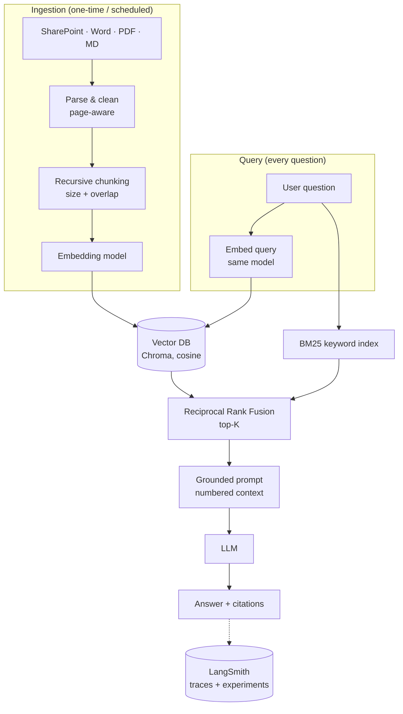

# enterprise-rag-reference

[](https://github.com/sureshmanem/enterprise-rag-reference/actions/workflows/ci.yml)


A small, production-minded **Retrieval-Augmented Generation (RAG)** reference implementation in Python.
It ingests SharePoint, Word, PDF and Markdown documents, indexes them in a vector database, and answers
questions with an LLM that is grounded in, and cites, your own documents.

Uses **OpenAI** by default; switch one environment variable to use **Azure OpenAI / Azure AI Foundry**.
Every question is traced end to end in **LangSmith**, and retrieval quality is measured against a golden set.

The Python package and CLI are called `rag-mini` / `rag`.

## Architecture



## Best practices implemented

| Area | Practice | Where |
|---|---|---|
| Parsing | PDFs split per page so citations include page numbers; text normalised; empty/scanned pages reported | `loaders.py` |
| Parsing | SharePoint via Microsoft Graph with app-only auth, secrets from env, pagination handled | `loaders.py` |
| Chunking | Recursive, structure-aware splitting (headings → paragraphs → sentences → words), never mid-word | `chunking.py` |
| Chunking | Configurable overlap so facts on a boundary stay retrievable; section heading kept as metadata | `chunking.py` |
| Chunking | **Document title on every chunk**, shown in each prompt passage, so a mid-document passage stays attributable to its policy and ID | `chunking.py`, `prompting.py` |
| Indexing | Deterministic chunk IDs → idempotent upserts; stale chunks deleted when a source changes | `vectorstore.py`, `pipeline.py` |
| Embeddings | **Embedding model pinned to the collection** – querying with a different model fails loudly | `vectorstore.py` |
| Embeddings | Batching + exponential backoff with jitter for rate limits (429) and transient errors | `providers.py` |
| Retrieval | **Hybrid search**: dense vectors + BM25 keywords fused with RRF (catches IDs like `HR-POL-021`) | `retrieval.py` |
| Retrieval | **Identifier-aware keywords**: IDs like `FIN-POL-012` are indexed whole, and passages containing an exact ID from the query rank first | `retrieval.py` |
| Retrieval | Minimum relevance threshold and near-duplicate removal before top-K | `retrieval.py` |
| Generation | Answer only from context, explicit "I don't know" fallback, mandatory `[n]` citations | `prompting.py` |
| Generation | Context treated as data (prompt-injection hygiene) and trimmed to a character budget | `prompting.py` |
| Output | Typed `Answer` with citations and a `grounded` flag (Pydantic contracts end to end) | `models.py` |
| Config | All tunables in validated settings (`RAG_*` env vars / `.env`) | `config.py` |
| Quality | Golden-set evaluation: hit-rate@K, MRR, answer accuracy, groundedness | `eval/` |
| Quality | Unit tests + API-backed integration tests (skipped without credentials) + GitHub Actions CI | `tests/`, `.github/` |
| Ops | Timing logs for retrieval vs generation; `/health` endpoint; Dockerfile | `pipeline.py`, `api.py` |
| Observability | **LangSmith tracing**: one trace per question (retrieval → embedding → LLM) with tokens, latency, retrieved passages and config metadata | `tracing.py` |
| Quality | Golden set synced to a LangSmith dataset; each eval run (local or CI, per commit) logged as a comparable experiment tagged with commit and branch | `eval/run_eval.py`, `.github/` |

## Quickstart

```bash
git clone https://github.com/sureshmanem/enterprise-rag-reference.git && cd enterprise-rag-reference
python -m venv .venv && source .venv/bin/activate
pip install -e ".[dev]"
cp .env.example .env   # then set RAG_OPENAI_API_KEY=sk-...

rag ingest data/sample
rag ask "How many leave days do I get per year?"
# Full-time employees receive 20 days of paid annual leave per calendar year [1].
#   [1] leave_policy.md
rag ask "What does FIN-POL-012 say about payment terms?"
# Contoso's standard payment terms are 45 days from the date a correct invoice is received [2].
#   [2] procurement_policy.md

rag serve            # chat UI at http://127.0.0.1:8000
pytest               # unit + integration tests (integration needs an API key)
python eval/run_eval.py              # hybrid retrieval
python eval/run_eval.py --no-hybrid  # vector-only, for comparison
```

## Sample data

`data/sample/` holds ten fictional Contoso policies from different departments. They deliberately share
similar facts (several "within 24 hours" and "within 30 days" rules, many USD amounts, look-alike policy
IDs) so retrieval has to discriminate rather than just find the only matching document.

| File | Department | Policy ID | Covers |
|---|---|---|---|
| `leave_policy.md` | HR | HR-POL-014 | Annual, sick and parental leave |
| `remote_work.md` | HR | HR-POL-021 | Remote eligibility, equipment, VPN |
| `benefits_overview.md` | HR | HR-POL-030 | Health insurance, 401(k), wellness, EAP |
| `learning_development.md` | HR | HR-POL-040 | Training budget, learning days, tuition |
| `expenses_policy.md` | Finance | FIN-POL-007 | Travel meals, hotels, expense reports |
| `procurement_policy.md` | Finance | FIN-POL-012 | POs, approval thresholds, quotes, suppliers |
| `it_acceptable_use.md` | IT | IT-POL-003 | Passwords, MFA, software, data storage |
| `code_of_conduct.md` | Legal | LEG-POL-001 | Gifts, conflicts of interest, speaking up |
| `data_privacy.md` | Legal | LEG-POL-002 | Classification, GDPR, breach reporting |
| `facilities_safety.md` | Facilities | FAC-POL-005 | Office access, desks, visitors, fire safety |

### Use Azure OpenAI (Azure AI Foundry)

```bash
# in .env:
RAG_PROVIDER=azure
RAG_AZURE_ENDPOINT=https://<resource>.openai.azure.com/
RAG_AZURE_API_KEY=<key>
RAG_EMBEDDING_MODEL=<embedding-deployment-name>
RAG_CHAT_MODEL=<chat-deployment-name>
RAG_COLLECTION=documents_te3small   # name collections after the embedding model
```

Changing the embedding model requires re-indexing into a new collection; the store enforces this.

### Trace with LangSmith

Create an API key at [smith.langchain.com](https://smith.langchain.com) and add to `.env`:

```bash
LANGSMITH_TRACING=true
LANGSMITH_API_KEY=lsv2_...
LANGSMITH_PROJECT=rag-mini
```

Every `rag ask` / `POST /ask` then appears as a trace:

```
rag.ask            question, answer, citations; metadata: models, top_k, hybrid, collection
├── retrieve       retrieved passages with source, page, fused score and cosine similarity
│   └── embed      query embedding (model, dimension)
└── ChatOpenAI     full prompt, completion, token usage, latency
```

`rag ingest` is traced as `rag.ingest` with chunk and stale-removal counts. Tests disable tracing.

Log an evaluation run as a LangSmith experiment (the golden set is synced to the
`rag-mini-golden` dataset), then compare configurations side by side in the UI:

```bash
python eval/run_eval.py --langsmith
python eval/run_eval.py --langsmith --no-hybrid
```

Experiments are named `<chat-model>-<mode>-k<top_k>-<commit>` (for example
`gpt-4o-mini-hybrid-k5-f1a9fb4-…`) and carry the commit, branch and `source` (`local` or
`github-actions`, plus the CI run URL) as metadata. CI logs one automatically on every push; see
[Testing](#testing). Open **Datasets → rag-mini-golden → Experiments** in LangSmith to compare runs.

### Index SharePoint

Register an Entra ID app with the `Sites.Read.All` application permission, set `SP_TENANT_ID`,
`SP_CLIENT_ID`, `SP_CLIENT_SECRET`, then:

```bash
rag ingest-sharepoint --hostname contoso.sharepoint.com --site sites/HR --folder Policies
```

## Evaluation

`python eval/run_eval.py` reports hit-rate@K, MRR, answer accuracy and groundedness against
`eval/golden.jsonl` (26 questions across all ten policies) using the configured models.

Results on the sample data (`text-embedding-3-small`, `gpt-4o-mini`, top-K 5, chunk size 1000):

| Mode | hit-rate@5 | MRR | answer accuracy | grounded |
|---|---|---|---|---|
| Hybrid (vector + BM25) | 1.0 | 1.0 | 1.0 | 1.0 |
| Vector only | 1.0 | 1.0 | 1.0 | 1.0 |

With ten short documents (17 chunks) the golden set no longer separates the two modes; it serves as
a regression gate. The policy-ID tests in `tests/` are where hybrid search earns its keep: a bare query
like `HR-POL-021` is found reliably only through the keyword side. Add multi-document and look-alike
questions from your own corpus to tune chunk size, overlap and top-K.

## Testing

```bash
pytest                       # 20 tests: 10 unit + 10 integration
RAG_SKIP_INTEGRATION=1 pytest   # unit tests only, no API calls
```

Integration tests (`@pytest.mark.integration`) call the real embedding and chat APIs and are skipped
automatically when no credentials are configured.

**CI** (GitHub Actions, Python 3.10 and 3.12) runs ruff and the tests on every push and pull request.
To run the integration tests and the evaluation in CI too, add repository secrets:

```bash
gh secret set RAG_OPENAI_API_KEY   # integration tests + evaluation
gh secret set LANGSMITH_API_KEY    # optional: log each CI evaluation as a LangSmith experiment
```

With `LANGSMITH_API_KEY` set, every CI run adds an experiment to the `rag-mini-golden` dataset, named
`<chat-model>-<mode>-k<top_k>-<commit>` and tagged with commit, branch and the CI run URL, so answer
quality can be compared commit by commit. Tests are never traced. CI can also be started manually from
**Actions → CI → Run workflow**.

## Project layout

```
src/ragmini/
  config.py      typed settings
  models.py      Document, Chunk, Answer contracts
  loaders.py     PDF / DOCX / MD / SharePoint
  chunking.py    recursive chunker with overlap
  providers.py   OpenAI and Azure OpenAI
  vectorstore.py Chroma with model pinning
  retrieval.py   hybrid retrieval + RRF
  prompting.py   grounded prompt + citations
  tracing.py     LangSmith setup + retriever trace formatting
  pipeline.py    ingest() and ask()
  api.py / cli.py
data/sample/     ten sample policies
eval/            golden set + metrics (+ LangSmith experiments)
tests/           unit + integration tests
```

## Production next steps

- Swap Chroma for **Azure AI Search** (native hybrid + semantic ranker) at scale.
- Add a **cross-encoder re-ranker** after fusion.
- Enforce **document-level permissions** (security trimming) using SharePoint ACLs as metadata filters.
- Incremental sync with Graph delta queries; OCR for scanned PDFs.
- LLM-as-judge faithfulness evaluators in LangSmith; user feedback (thumbs up/down) attached to traces.
- Prepend the document title to chunk text before embedding (contextual retrieval) and fix section
  labels for chunks that start mid-section.

## License

MIT
