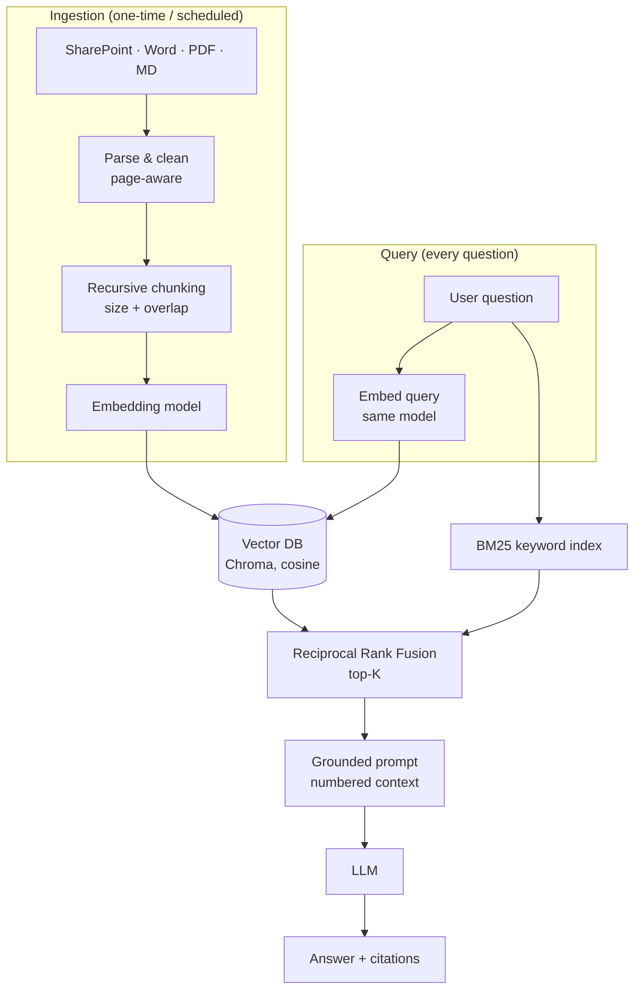

# rag-mini

A small, production-minded **Retrieval-Augmented Generation (RAG)** reference implementation in Python.
It ingests SharePoint, Word, PDF and Markdown documents, indexes them in a vector database, and answers
questions with an LLM that is grounded in, and cites, your own documents.

Uses **OpenAI** by default; switch one environment variable to use **Azure OpenAI / Azure AI Foundry**.

## Architecture



## Best practices implemented

| Area | Practice | Where |
|---|---|---|
| Parsing | PDFs split per page so citations include page numbers; text normalised; empty/scanned pages reported | `loaders.py` |
| Parsing | SharePoint via Microsoft Graph with app-only auth, secrets from env, pagination handled | `loaders.py` |
| Chunking | Recursive, structure-aware splitting (headings → paragraphs → sentences → words), never mid-word | `chunking.py` |
| Chunking | Configurable overlap so facts on a boundary stay retrievable; section heading kept as metadata | `chunking.py` |
| Indexing | Deterministic chunk IDs → idempotent upserts; stale chunks deleted when a source changes | `vectorstore.py`, `pipeline.py` |
| Embeddings | **Embedding model pinned to the collection** – querying with a different model fails loudly | `vectorstore.py` |
| Embeddings | Batching + exponential backoff with jitter for rate limits (429) and transient errors | `providers.py` |
| Retrieval | **Hybrid search**: dense vectors + BM25 keywords fused with RRF (catches IDs like `HR-POL-021`) | `retrieval.py` |
| Retrieval | Minimum relevance threshold and near-duplicate removal before top-K | `retrieval.py` |
| Generation | Answer only from context, explicit "I don't know" fallback, mandatory `[n]` citations | `prompting.py` |
| Generation | Context treated as data (prompt-injection hygiene) and trimmed to a character budget | `prompting.py` |
| Output | Typed `Answer` with citations and a `grounded` flag (Pydantic contracts end to end) | `models.py` |
| Config | All tunables in validated settings (`RAG_*` env vars / `.env`) | `config.py` |
| Quality | Golden-set evaluation: hit-rate@K, MRR, answer accuracy, groundedness | `eval/` |
| Quality | Unit tests + API-backed integration tests (skipped without credentials) + GitHub Actions CI | `tests/`, `.github/` |
| Ops | Timing logs for retrieval vs generation; `/health` endpoint; Dockerfile | `pipeline.py`, `api.py` |
| Observability | **LangSmith tracing**: one trace per question (retrieval → embedding → LLM) with tokens, latency, retrieved passages and config metadata | `tracing.py` |
| Quality | Golden set synced to a LangSmith dataset; each eval run logged as a comparable experiment | `eval/run_eval.py` |

## Quickstart

```bash
python -m venv .venv && source .venv/bin/activate
pip install -e ".[dev]"
cp .env.example .env   # then set RAG_OPENAI_API_KEY=sk-...

rag ingest data/sample
rag ask "How many leave days do I get per year?"
# Full-time employees receive 20 days of paid annual leave per calendar year. [1]
#   [1] leave_policy.md

rag serve            # chat UI at http://127.0.0.1:8000
pytest               # unit + integration tests (integration needs an API key)
python eval/run_eval.py              # hybrid retrieval
python eval/run_eval.py --no-hybrid  # vector-only, for comparison
```

### Use Azure OpenAI (Azure AI Foundry)

```bash
# in .env:
RAG_PROVIDER=azure
RAG_AZURE_ENDPOINT=https://<resource>.openai.azure.com/
RAG_AZURE_API_KEY=<key>
RAG_EMBEDDING_MODEL=<embedding-deployment-name>
RAG_CHAT_MODEL=<chat-deployment-name>
RAG_COLLECTION=documents_te3small   # name collections after the embedding model
```

Changing the embedding model requires re-indexing into a new collection; the store enforces this.

### Trace with LangSmith

Create an API key at [smith.langchain.com](https://smith.langchain.com) and add to `.env`:

```bash
LANGSMITH_TRACING=true
LANGSMITH_API_KEY=lsv2_...
LANGSMITH_PROJECT=rag-mini
```

Every `rag ask` / `POST /ask` then appears as a trace:

```
rag.ask            question, answer, citations; metadata: models, top_k, hybrid, collection
├── retrieve       retrieved passages with source, page, fused score and cosine similarity
│   └── embed      query embedding (model, dimension)
└── ChatOpenAI     full prompt, completion, token usage, latency
```

`rag ingest` is traced as `rag.ingest` with chunk and stale-removal counts. Tests disable tracing.

Log an evaluation run as a LangSmith experiment (the golden set is synced to the
`rag-mini-golden` dataset), then compare configurations side by side in the UI:

```bash
python eval/run_eval.py --langsmith
python eval/run_eval.py --langsmith --no-hybrid
```

### Index SharePoint

Register an Entra ID app with the `Sites.Read.All` application permission, set `SP_TENANT_ID`,
`SP_CLIENT_ID`, `SP_CLIENT_SECRET`, then:

```bash
rag ingest-sharepoint --hostname contoso.sharepoint.com --site sites/HR --folder Policies
```

## Evaluation

`python eval/run_eval.py` reports hit-rate@K, MRR, answer accuracy and groundedness against
`eval/golden.jsonl` using the configured models. Run it with your own golden set to tune chunk size,
overlap and top-K, and compare `--hybrid` vs `--no-hybrid`. CI runs it when the
`RAG_OPENAI_API_KEY` repository secret is set.

## Project layout

```
src/ragmini/
  config.py      typed settings
  models.py      Document, Chunk, Answer contracts
  loaders.py     PDF / DOCX / MD / SharePoint
  chunking.py    recursive chunker with overlap
  providers.py   OpenAI and Azure OpenAI
  vectorstore.py Chroma with model pinning
  retrieval.py   hybrid retrieval + RRF
  prompting.py   grounded prompt + citations
  tracing.py     LangSmith setup + retriever trace formatting
  pipeline.py    ingest() and ask()
  api.py / cli.py
eval/            golden set + metrics
tests/           unit + integration tests
```

## Production next steps

- Swap Chroma for **Azure AI Search** (native hybrid + semantic ranker) at scale.
- Add a **cross-encoder re-ranker** after fusion.
- Enforce **document-level permissions** (security trimming) using SharePoint ACLs as metadata filters.
- Incremental sync with Graph delta queries; OCR for scanned PDFs.
- LLM-as-judge faithfulness evaluators in LangSmith; user feedback (thumbs up/down) attached to traces.

## License

MIT
